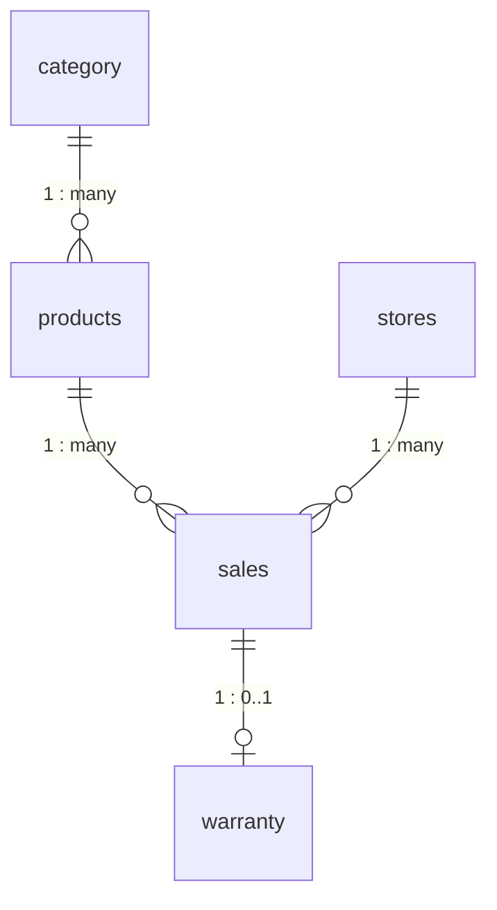
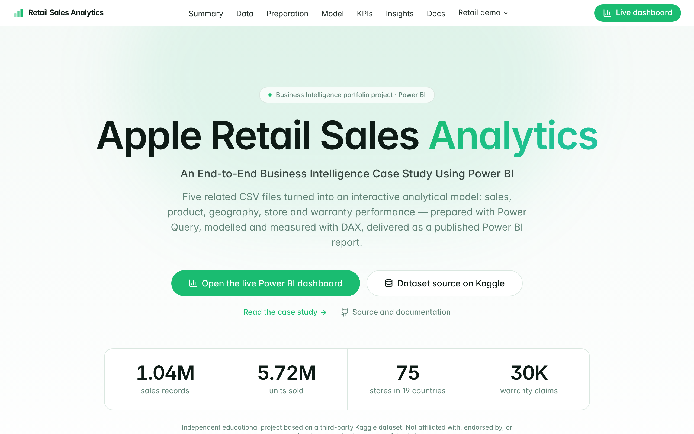
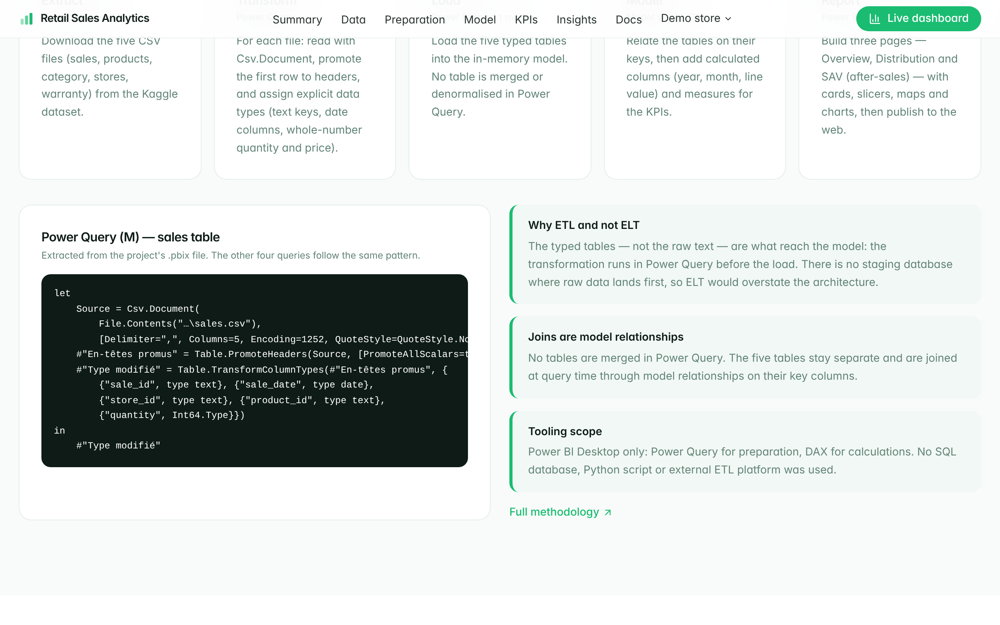
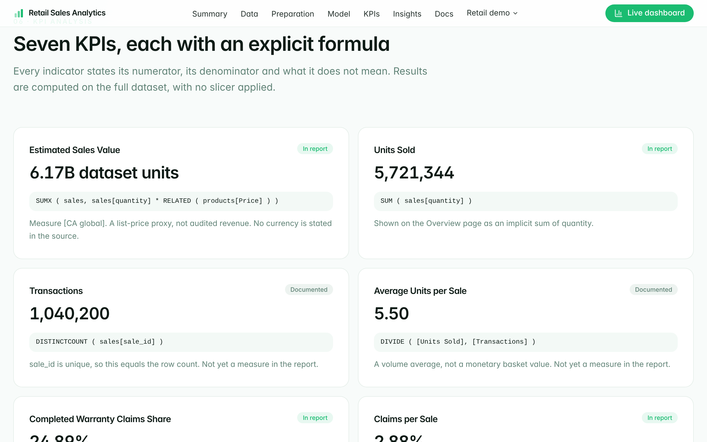
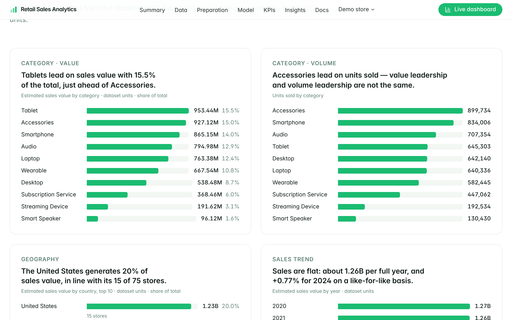
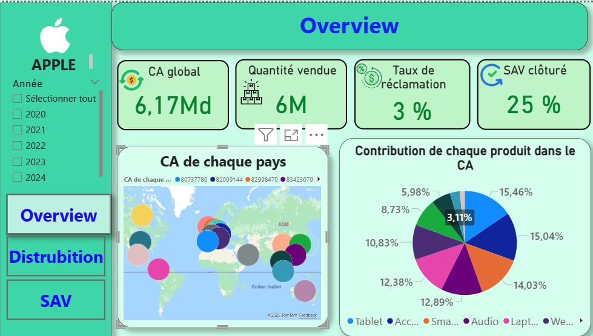
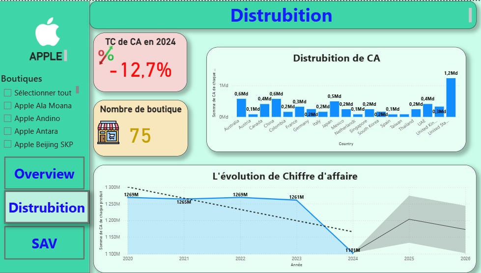
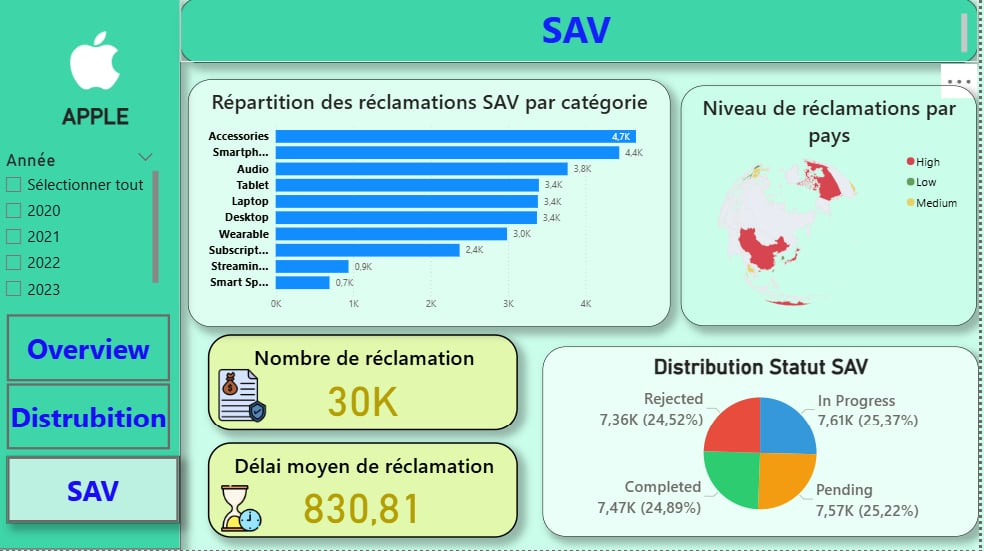
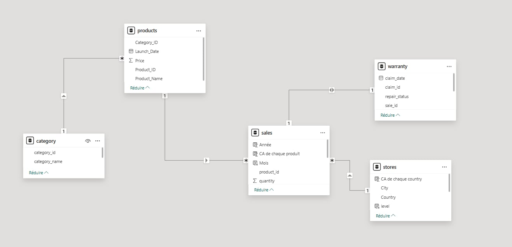
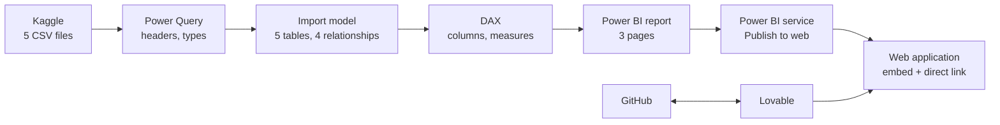

<p align="center">
  
</p>

# Apple Retail Sales Analytics

**An End-to-End Business Intelligence Case Study Using Power BI**

Five related CSV files turned into an interactive analytical solution covering
sales, product, geographical, store and warranty performance — prepared with
Power Query, modelled and measured with DAX, published as a Power BI report and
presented in a web application.

| | |
| --- | --- |
| **Live Power BI dashboard** | **[Open the published report](https://app.powerbi.com/view?r=eyJrIjoiNjNjZTE3ZmUtNzAzNC00ODA3LWJkMGMtYWQ4MTNlYTUzNGE1IiwidCI6ImRiZDY2NjRkLTRlYjktNDZlYi05OWQ4LTVjNDNiYTE1M2M2MSIsImMiOjl9)** |
| **Live web application** | **[apple-demo.lovable.app](https://apple-demo.lovable.app)** |
| **Dataset** | [Apple Retail Sales Dataset on Kaggle](https://www.kaggle.com/datasets/amangarg08/apple-retail-sales-dataset) |
| **Author** | Edam Ketata — Business Intelligence student |

> **Independent educational project.** It uses a third-party Kaggle dataset. It
> is not an official Apple Inc. report, does not contain Apple's confidential
> business data, and is not affiliated with or endorsed by Apple Inc.

---

## Contents

1. [Business problem](#business-problem)
2. [Project objectives](#project-objectives)
3. [Dataset](#dataset)
4. [Technology stack](#technology-stack)
5. [Data preparation methodology](#data-preparation-methodology)
6. [Data model](#data-model)
7. [KPI definitions](#kpi-definitions)
8. [Key findings](#key-findings)
9. [Dashboard overview](#dashboard-overview)
10. [Screenshots](#screenshots)
11. [System architecture](#system-architecture)
12. [Run the web application locally](#run-the-web-application-locally)
13. [Repository structure](#repository-structure)
14. [Data limitations](#data-limitations)
15. [Security and licensing](#security-and-licensing)
16. [Disclaimer](#disclaimer)

---

## Business problem

A retail network sells 89 products through 75 stores in 19 countries and
receives warranty claims on part of those sales. The raw data sits in five
separate files. Decision-makers need one consistent view to answer:

- How do sales value, volume and transactions evolve over time?
- Which categories and products contribute most?
- Which countries, cities and stores concentrate performance?
- How are warranty claims distributed by status, category and country?

More in [docs/business-understanding.md](docs/business-understanding.md).

## Project objectives

1. Build one analytical model from five raw CSV files.
2. Define clear, reproducible KPIs with explicit formulas.
3. Deliver an interactive report for non-technical users.
4. Document the method, the data quality and the limits of the data.

## Dataset

Source: <https://www.kaggle.com/datasets/amangarg08/apple-retail-sales-dataset>

| File | Rows | Key fields | Role |
| --- | ---: | --- | --- |
| `sales.csv` | 1,040,200 | `sale_id`, `sale_date`, `store_id`, `product_id`, `quantity` | Sales fact table |
| `products.csv` | 89 | `Product_ID`, `Product_Name`, `Category_ID`, `Launch_Date`, `Price` | Product dimension and list price |
| `category.csv` | 10 | `category_id`, `category_name` | Category lookup |
| `stores.csv` | 75 | `Store_ID`, `Store_Name`, `City`, `Country` | Store and geography dimension |
| `warranty.csv` | 30,000 | `claim_id`, `claim_date`, `sale_id`, `repair_status` | Warranty claims |

- **Sales period:** 1 January 2020 – 12 November 2024
- **Warranty claim period:** 1 January 2024 – 12 November 2024
- **Geography:** 75 stores, 47 cities, 19 countries

- **Licence:** MIT, as displayed on the Kaggle page
- **Nature:** synthetic — the publisher states it "is not based on real Apple Inc. data"

All figures in this repository were recomputed from the data loaded in the
Power BI model. The raw files are not stored here; see
[Security and licensing](#security-and-licensing).

More in [docs/data-understanding.md](docs/data-understanding.md) and
[docs/data-quality.md](docs/data-quality.md).

## Technology stack

| Area | Tools |
| --- | --- |
| Data preparation | Power Query (M) in Power BI Desktop |
| Modelling and calculations | Power BI import model, DAX |
| Reporting | Power BI report, published to the web |
| Web application | React 18, TypeScript, Vite, Tailwind CSS, shadcn/ui |
| Hosting and sync | Lovable, GitHub |

No SQL database, Python script or external ETL platform was used: the BI work
is entirely in Power BI Desktop.

## Data preparation methodology

The workflow is a light **ETL** process: Power Query transforms each file before
it is loaded into the model.

| Step | Tool | What happens |
| --- | --- | --- |
| Extract | Kaggle → CSV | Download the five source files |
| Transform | Power Query | Promote headers, assign data types (text keys, dates, whole numbers) |
| Load | Import model | Load five typed tables |
| Model | Model view, DAX | Four relationships, calculated columns, measures |
| Report | Power BI | Three pages, published to the web |

The tables are not merged in Power Query; they are joined through model
relationships. Why this is ETL rather than ELT is explained in
[docs/methodology.md](docs/methodology.md). The actual M code is in
[powerbi/power-query.pq](powerbi/power-query.pq).

## Data model



| One side | Many / dependent side | Cardinality | Filter direction |
| --- | --- | --- | --- |
| `category[category_id]` | `products[Category_ID]` | 1 : many | Single |
| `products[Product_ID]` | `sales[product_id]` | 1 : many | Single |
| `stores[Store_ID]` | `sales[store_id]` | 1 : many | Single |
| `sales[sale_id]` | `warranty[sale_id]` | 1 : 1 in Power BI (logically 1 : 0..1) | Both |

**Classification:** a snowflake-style relational model with a single fact table
(`sales`). It is not a classical star schema: `category` is normalised out of
`products`, `warranty` is a second transactional table rather than a dimension,
and there is no dedicated date table.

All primary keys are unique and no foreign key is orphaned. More in
[docs/data-model.md](docs/data-model.md).

## KPI definitions

| KPI | Formula | Result |
| --- | --- | ---: |
| Estimated Sales Value | `SUMX ( sales, sales[quantity] * RELATED ( products[Price] ) )` | 6.17B dataset units |
| Units Sold | `SUM ( sales[quantity] )` | 5,721,344 |
| Transactions | `DISTINCTCOUNT ( sales[sale_id] )` | 1,040,200 |
| Average Units per Sale | Units Sold ÷ Transactions | 5.50 |
| Completed Warranty Claims Share | Completed claims ÷ all claims | 24.89% |
| Claims per Sale | Claims ÷ sale lines | 2.88% |
| Comparable Year-over-Year Change | 2024 YTD ÷ 2023 YTD − 1, both 1 Jan – 12 Nov | +0.77% value, +0.64% units |

- **No currency.** The dataset states none, so sales value is a list-price ×
  quantity proxy in *dataset units* — not revenue, profit or margin.
- **No repair duration.** There is no repair completion date, so processing
  time is not measured.

Full definitions, numerators, denominators and caveats:
[docs/kpi-definitions.md](docs/kpi-definitions.md). DAX extracted from the
report: [powerbi/measures.dax](powerbi/measures.dax).

## Key findings

- **Tablets lead on value, Accessories on volume.** Tablets account for 953.4M
  (15.5% of sales value); Accessories for 899,734 units, the highest volume.
- **The United States is the largest market:** 1.23B, 20.0% of sales value,
  with 15 of the 75 stores. Value per store is nearly identical across the
  network, so country rank mostly follows store count.
- **Sales are flat.** Each full year totals about 1.26B. On a like-for-like
  basis, 2024 is +0.77% in value against 2023.
- **Warranty statuses are evenly split:** 24.9% completed, 25.4% in progress,
  25.2% pending, 24.5% rejected, out of 30,000 claims.
- **Claims follow sales volume:** Accessories (4,650) and Smartphones (4,434)
  have the most claims.

The dataset is synthetic (stated on its Kaggle page), which explains how
uniform these results are; they describe this dataset only.

## Dashboard overview

**[Open the live Power BI report](https://app.powerbi.com/view?r=eyJrIjoiNjNjZTE3ZmUtNzAzNC00ODA3LWJkMGMtYWQ4MTNlYTUzNGE1IiwidCI6ImRiZDY2NjRkLTRlYjktNDZlYi05OWQ4LTVjNDNiYTE1M2M2MSIsImMiOjl9)**
(interface in French)

| Page | Content |
| --- | --- |
| **Overview** | Sales value, units sold, claims per sale, completed claim share, value by country and by category, year slicer |
| **Distribution** ¹ | Store count, year-over-year card, value by country and city, annual trend, store slicer |
| **SAV** (after-sales) | Claim count, claims by status and by category, claim level by country |

¹ Spelled "Distrubition" in the currently published report; the correction is
the first item of the update checklist.

A review of the report is in
[powerbi/improvement-report.md](powerbi/improvement-report.md), and the manual
changes still to apply are in
[powerbi/pbix-update-checklist.md](powerbi/pbix-update-checklist.md). Two cards in the
published report differ from the definitions used here (the 2024 growth card
and the claim-delay card); the report explains why.

## Screenshots

### Web application

| Overview | Data model |
| --- | --- |
|  |  |

| KPI analysis | Business insights |
| --- | --- |
|  |  |

### Power BI report

Captured in Power BI Desktop, before the improvements listed in the review.

| Overview | Distribution |
| --- | --- |
|  |  |

| SAV (after-sales) | Model view |
| --- | --- |
|  |  |

## System architecture



More in [docs/architecture.md](docs/architecture.md).

## Run the web application locally

Requirements: Node.js 18 or later and npm.

```bash
git clone https://github.com/Edambi12/apple-sales-bi-platform.git
```

```bash
cd apple-sales-bi-platform
```

```bash
npm install
```

```bash
npm run dev
```

The app runs at <http://localhost:8080>.

| Command | Purpose |
| --- | --- |
| `npm run dev` | Development server |
| `npm run build` | Production build |
| `npm run preview` | Serve the production build |
| `npm run lint` | ESLint |

Environment variables are needed only for the optional retail demo checkout.
Copy `.env.example` to `.env` and fill in your own values; the case study works
without them.

To rebuild the Power BI report from the source files, follow
[powerbi/README.md](powerbi/README.md).

## Repository structure

```
.
├── README.md
├── .env.example                 Placeholder environment variables
├── docs/
│   ├── business-understanding.md
│   ├── data-understanding.md
│   ├── methodology.md
│   ├── data-model.md
│   ├── kpi-definitions.md
│   ├── architecture.md
│   ├── data-quality.md
│   ├── limitations.md
│   ├── security.md
│   ├── assets/                  README banner
│   ├── screenshots/             Application and Power BI screenshots
│   └── archive/original-slides/ First planning slides (superseded)
├── powerbi/
│   ├── README.md
│   ├── measures.dax             Measures extracted from the report
│   ├── calculated-columns.dax   Calculated columns extracted from the report
│   ├── power-query.pq           Power Query (M) queries
│   ├── model-documentation.md
│   ├── improvement-report.md    Review and recommendations
│   ├── pbix-update-checklist.md Manual changes to apply in Power BI Desktop
│   └── recommended-measures.dax Proposed measures (not yet in the report)
├── src/
│   ├── config/links.ts          Public URLs
│   ├── data/caseStudy.ts        Verified figures shown in the app
│   ├── components/case-study/   Case-study sections and charts
│   ├── components/layout/       Navigation, footer
│   ├── pages/                   Routes
│   └── …                        Retail demo pages and UI primitives
└── supabase/                    Edge function used by the demo checkout
```

The application also keeps four retail demo pages (in French) under *Retail
demo*: products, stores, support and warranty, and a cart. Their content is
fictional sample data, labelled as such on every page, and is unrelated to the
dataset.

## Data limitations

- No currency, cost or discount fields: no revenue in a currency, profit or margin.
- No repair completion date: no repair-processing time.
- Warranty claims cover 2024 only; sales cover 2020–2024.
- 2024 is a partial year (ends 12 November).
- 9% of claims are dated before their linked sale.
- The data is synthetic, as stated by its publisher.

More in [docs/limitations.md](docs/limitations.md).

## Security and licensing

- `.env` files are excluded from version control; `.env.example` holds
  placeholders only. A `.env` file was tracked in earlier commits. It contained
  only Supabase *publishable* (anon) client values, which are designed to be
  exposed in a browser.
- **No secret in the browser.** The demo checkout calls a Supabase Edge
  Function that holds the email API key and recipient settings server-side.
  The database has no public tables. Details: [docs/security.md](docs/security.md).
- **Dataset licence: MIT**, as displayed on the Kaggle page (checked
  10 November 2026). The raw CSV files are not stored here; download them from
  Kaggle. See [docs/limitations.md](docs/limitations.md#licensing).
- The repository does not yet declare a licence for its own code and
  documentation.

## Disclaimer

This is an independent educational Business Intelligence project. Apple and the
product names appearing in the dataset are trademarks of Apple Inc., used only
to describe the dataset's content. The figures are calculated from a public
third-party dataset and do not represent Apple Inc.'s actual sales, stores or
after-sales activity.
