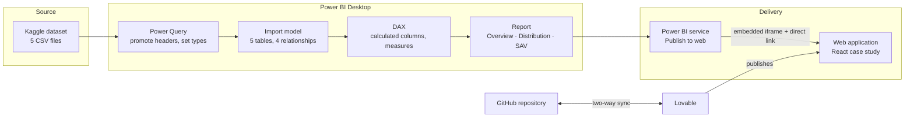

# Architecture

## Solution overview



## Components

| Layer | Technology | Responsibility |
| --- | --- | --- |
| Source | Kaggle CSV files | Raw sales, product, category, store and warranty data |
| Preparation | Power Query (M) | File import, header promotion, data typing |
| Semantic model | Power BI import model (VertiPaq) | Storage, relationships, filter propagation |
| Calculations | DAX | KPIs and derived columns |
| Presentation | Power BI report | Three interactive pages |
| Distribution | Power BI service, Publish to web | Public report URL |
| Case study | React, TypeScript, Vite, Tailwind CSS, shadcn/ui | Explains the project and embeds the report |
| Hosting | Lovable | Builds and serves the web application |
| Source control | GitHub | Code, documentation, sync with Lovable |

## Web application

The application is a static single-page app. It does not query the dataset: the
figures it displays are constants in
[`src/data/caseStudy.ts`](../src/data/caseStudy.ts), each recomputed from the
data in the `.pbix` file. The interactive analysis lives in the embedded Power
BI report.

```
src/
├── config/links.ts            Public URLs (report, dataset, repository)
├── data/caseStudy.ts          Verified figures, KPI and model metadata
├── components/
│   ├── case-study/            Section layout, bar list, model diagram, Power BI embed
│   │   └── sections/          One component per case-study section
│   ├── layout/                Navigation, footer, scroll and error handling
│   ├── products/, checkout/   Retail demo (fictional UI sample)
│   └── ui/                    shadcn/ui primitives
├── pages/                     Route components
└── integrations/supabase/     Generated client, used by the demo checkout only
```

| Route | Content |
| --- | --- |
| `/` | The case study |
| `/analytics` | Full-width embedded Power BI report |
| `/produits`, `/produits/:id` | Retail demo: product catalogue (fictional, French) |
| `/boutiques` | Retail demo: store locator (fictional) |
| `/support` | Retail demo: FAQ and warranty-claim status lookup (fictional) |
| `/panier` | Retail demo: cart and simulated checkout |

The retail demo is a user-interface exercise with invented products, stores and
prices, labelled as fictional on every page. It has no connection to the Kaggle
dataset. The pages for company information, careers, news, user account and the
former storefront home were removed because they were unrelated to the project.

The checkout simulates payment and calls a Supabase Edge Function
(`supabase/functions/send-order-confirmation`) that sends a confirmation email
through Resend. This is the only backend in the project; its security model is
described in [security.md](security.md).

## Design decisions

- **Embed and link.** The report is embedded in an iframe, and a direct link is
  always shown next to it, because corporate networks often block embedded
  content.
- **Deferred embed on the home page.** The iframe loads only on request, which
  keeps the first page light.
- **Route-level code splitting.** Secondary pages are lazy-loaded, and an error
  boundary keeps a failing page from blanking the whole app.
- **One source for figures and links.** Numbers and URLs are defined once and
  imported everywhere.
