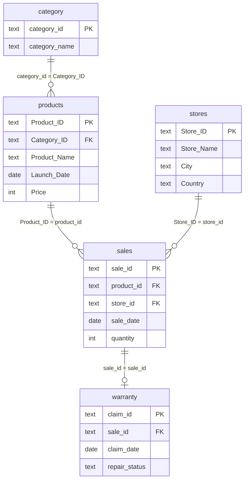
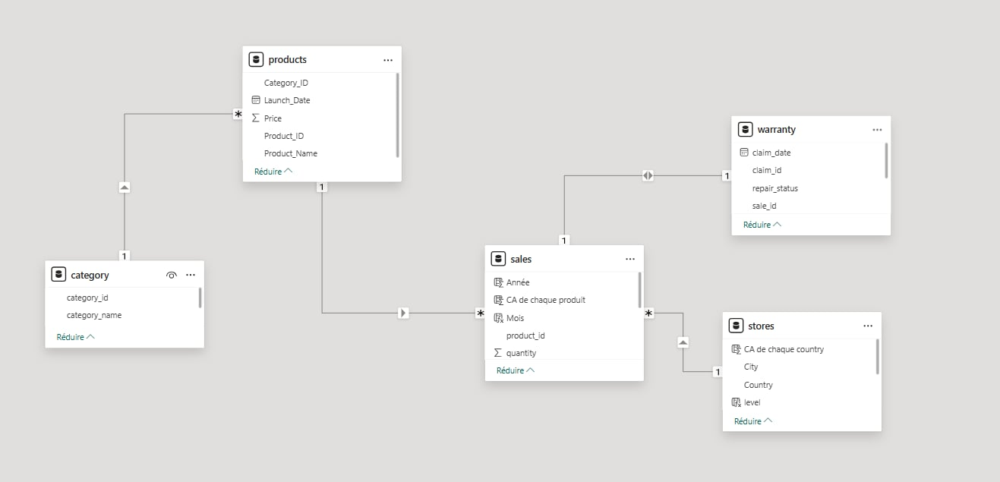

# Data model

## Diagram

Model view in Power BI Desktop:

## Relationships

| One side | Many / dependent side | Cardinality | Cross-filter direction |
| --- | --- | --- | --- |
| `category[category_id]` | `products[Category_ID]` | 1 : many | Single |
| `products[Product_ID]` | `sales[product_id]` | 1 : many | Single |
| `stores[Store_ID]` | `sales[store_id]` | 1 : many | Single |
| `sales[sale_id]` | `warranty[sale_id]` | 1 : 1 in Power BI (logically 1 : 0..1) | Both |

## Key validation

| Check | Result |
| --- | --- |
| `sales[sale_id]` unique | Yes — 1,040,200 distinct values |
| `products[Product_ID]`, `stores[Store_ID]`, `category[category_id]`, `warranty[claim_id]` unique | Yes |
| `warranty[sale_id]` unique | Yes — at most one claim per sale |
| Sales without a matching product or store | 0 |
| Products without a matching category | 0 |
| Claims without a matching sale | 0 |

## Classification: snowflake-style, not a classical star

A classical star schema has one fact table surrounded by denormalised dimensions,
each joined directly to the fact. This model differs in three ways:

1. **`category` is snowflaked.** It joins `products`, not `sales`, so the
   product dimension is normalised over two tables.
2. **`warranty` is not a dimension.** It is a second transactional table at
   claim grain, attached to the fact by `sale_id`.
3. **There is no date dimension.** Time attributes come from Power BI's
   automatic date tables and from calculated columns on `sales`.

The accurate description is a **snowflake-style relational model with a single
fact table (`sales`)**. The screenshot file in the original upload was named
"star-schema"; it has been renamed to reflect this.

## Filter propagation

- A filter on `category` reaches `products`, then `sales`, then — through the
  bi-directional one-to-one — `warranty`. Claims can therefore be sliced by
  category, product, store, city and country.
- Because that relationship is bi-directional, a filter on `warranty` (for
  example a repair status) also filters `sales` to the sales that have such a
  claim.
- A year filter on `sales[Année]` filters claims by the **year of the sale**.
  All claims were filed in 2024, so this is easy to misread.

## Proposed target model (not implemented)

These changes would turn the model into a conventional star schema:

| Change | Benefit |
| --- | --- |
| Add a marked `Date` table related to `sales[sale_date]` | Reliable time intelligence, correct month sorting, one shared calendar |
| Merge `category_name` into `products` | One product dimension, simpler filter path |
| Treat `warranty` as a second fact with its own relationship to `Date` (on `claim_date`) | Claims can be analysed by the date they were filed |
| Replace static calculated columns with measures | Maps and bands respond to slicers |

Details and DAX are in the
[Power BI improvement report](../powerbi/improvement-report.md).
